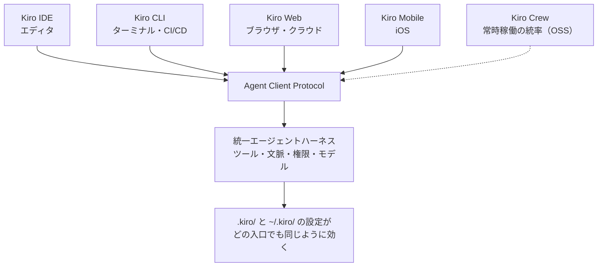

# 猫でもわかるKiro 入門 ― IDE・CLI・Web・Mobile・Crew まとめ

**Kiro は 1 つの AI コーディングエージェントに、5 つの入口がある。** このサイトは、Kiro を知らない人に向けて「Kiro とは何か」「なぜ今か」「どこから始めるか」を一次情報（kiro.dev の公式ブログ・ドキュメント・changelog）に基づいて案内する **非公式** の日本語サイトです。機能やバージョンごとの詳細は、入口ごとの姉妹サイト 4 本に任せています。

## 🐱 30 秒で分かる Kiro

- **誰が**: Amazon Web Services（AWS）が提供するエージェントです。Kiro IDE・Kiro CLI は AWS Customer Agreement のもとで提供されています（<https://kiro.dev/license/>）。
- **何をしてくれる**: あなたのリポジトリを読み、ファイルを編集し、シェルコマンドやテストを実行し、必要なら Web を調べます。ツールを動かす前に権限ルールを評価し、決めていない操作は許可を求めます（公式「How Kiro works」の 6 段階 <https://kiro.dev/docs/how-kiro-works/>）。
- **試すには**: 新規ユーザーは無料の **Kiro Free**（月 50 クレジット、一部モデルのみ）から始まります。GitHub・Google・AWS Builder ID のアカウントでサインインできます（<https://kiro.dev/docs/billing/>・<https://kiro.dev/docs/getting-started/authentication/>）。
- **用語**: 本サイトで繰り返し出る言葉は 4 つです。**ハーネス**（エージェント本体。会話・ツール実行・権限・モデル呼び出しを担う部分）、**steering**（プロジェクトの約束事を書いた Markdown。毎回エージェントに渡る）、**hooks**（ファイル保存やツール実行などのイベントで自動実行する処理）、**MCP**（Model Context Protocol。外部ツールをエージェントに接続する規格）。公式の説明は <https://kiro.dev/docs/steering/>・<https://kiro.dev/docs/hooks/>・<https://kiro.dev/docs/mcp/>。



（公式ドキュメント「How Kiro works」と公式ブログの説明をもとに本サイトが作成。Kiro Crew は Kiro CLI を介して Kiro のハーネスの上に作られた OSS で、常時稼働や記憶の一部は共有ハーネスの外に実装されています。出典: <https://kiro.dev/blog/introducing-kiro-crew/>・<https://kiro.dev/blog/which-kiro-app-should-i-pick/>）

## 🚪 5 つの入口

| 入口 | 向いている仕事（公式「Which Kiro app should I pick?」の整理） | くわしくは |
|---|---|---|
| **Kiro IDE** | エディタ（VS Code の基盤 Code OSS がベース）の中で AI と一緒にコードを書く。Agent Focus Mode（複数のエージェントセッションを並べて指揮する表示）にも切り替えられる | [猫でもわかるKiro IDE アップデート情報](https://github.com/kamogashira-sys/kiro-ide-docs) |
| **Kiro CLI** | ターミナルで作業する。人の手を介さずスクリプト・CI/CD パイプラインで動かす | [猫でもわかるKiro CLI アップデート情報](https://github.com/kamogashira-sys/q-cli-docs) |
| **Kiro Web** | クラウドの隔離環境でエージェントを動かし、ラップトップを閉じても作業が続く。各入口から起こしたクラウドセッションを一か所で見て操る。有料プラン（Pro 以上）向け | [猫でもわかるKiro Web アップデート情報](https://github.com/kamogashira-sys/kiro-web-docs) |
| **Kiro Mobile** | 移動中にセッションを起こす・承認する・様子を見る | 公式ドキュメント <https://kiro.dev/docs/mobile/>（本シリーズに Mobile 専用サイトはありません） |
| **Kiro Crew** | 記憶・スケジュール・非同期エージェントで、離れている間も仕事を進める。OSS | [猫でもわかるKiro Crewアップデート情報](https://github.com/kamogashira-sys/kiro-crew-docs) |
| （6 番目）ACP 対応エディタ | JetBrains IDE・Zed などから Kiro CLI を経由して同じエージェントを使う | <https://kiro.dev/docs/cli/acp/> |

公式はこの選び方を「どれを選ぶかではなく、この仕事にはどれか」と整理しています（<https://kiro.dev/blog/which-kiro-app-should-i-pick/>）。

## ⏱️ いまなぜ Kiro か

- 2026-08-03、公式ブログ「One agent, every surface」は、IDE（TypeScript）・CLI（Rust）・Web（Python）で別々だったエージェント本体を **1 つのハーネス** に統一したと公表しました。新機能を 3 回作る時代が終わり、設定が入口を越えて付いて回るようになりました。→ [1 つのエージェント、5 つの入口](kiro-all-docs/01_story/02_one-agent.md)
- 2026-10-09、Kiro CLI はその統一ハーネス（V3）を既定にするロールアウトを告知し、CLI 3.0 を予告しました。端末にも Specs（要件・設計・タスクを文書にしてから実装する進め方）、クラウドセッション、workflows（複数エージェントの手順を背景で実行）、memory（セッションを越えて文脈を覚える）が来ています。**V3 はハーネスの世代、3.0 は版番号**で、別の言葉です。→ [Kiro CLI の道](kiro-all-docs/01_story/03_cli-journey.md)
- 公式ドキュメントの言い方では「Kiro is one agent, available everywhere you work.」（<https://kiro.dev/docs/how-kiro-works/>）。

## 🚀 はじめる

**[はじめ方 ― Kiro CLI を 3 ステップで、ほかの入口は公式へ](kiro-all-docs/00_start/03_get-started.md)**

```bash
curl -fsSL https://cli.kiro.dev/install | bash   # macOS / Linux
kiro-cli login
kiro-cli chat
```

> 🐾 **筆者のひとこと**: 私は Kiro CLI が一番好きです。かゆいところに手が届く。`/compact`（会話の手動圧縮）のような操作を自分でできるのは、車でいうとマニュアル車。IDE 版はオートマ車で確かに楽ですが、細かなところまで自分で操作する手触りは薄い、というのが私の感想です。理由の全部は [なぜ筆者は Kiro CLI が好きなのか](kiro-all-docs/02_why-kiro-cli/01_why-i-love-kiro-cli.md) に書きました。

## 🧭 読者別の入口

| あなたは | ここから |
|---|---|
| Kiro を知らない開発者 | [はじめ方](kiro-all-docs/00_start/03_get-started.md) → [1 つのエージェント、5 つの入口](kiro-all-docs/01_story/02_one-agent.md) |
| Kiro IDE だけ使っている | [1 つのエージェント、5 つの入口](kiro-all-docs/01_story/02_one-agent.md)（設定が共有される仕組み）→ 姉妹サイト（CLI・Web・Crew） |
| ターミナル派・CI/CD 担当 | [Kiro CLI の道](kiro-all-docs/01_story/03_cli-journey.md) → [なぜ筆者は Kiro CLI が好きなのか](kiro-all-docs/02_why-kiro-cli/01_why-i-love-kiro-cli.md) → [CLI 版サイト](https://github.com/kamogashira-sys/q-cli-docs) |
| 旧 Amazon Q Developer CLI を使っていた | [Kiro CLI の道](kiro-all-docs/01_story/03_cli-journey.md)（2025-11-17 以降の経緯）→ [CLI 版サイト](https://github.com/kamogashira-sys/q-cli-docs)（旧 Q CLI のアーカイブあり） |
| 姉妹サイトの読者 | [目次](kiro-all-docs/README.md) |

## ✍️ 筆者の記事（Qiita）

| 公開日 | 記事 | 内容 |
|---|---|---|
| 2026-09-28 | [猫でもわかるKiro Web ― 端末を閉じても働き続けるKiroの正体](https://qiita.com/kamogashira/items/b1dd5f5dec37ca75206e) | JAWS-UG（AWS のユーザーコミュニティ）栃木 #10 登壇の再構成。統一ハーネスの新系列として提供される Kiro Web、Automation と Mobile の組み合わせ |
| 2026-08-29 | [Kiro５兄弟のいまどきのセキュリティ基礎知識 ― Kiro CLIとDraw.io MCPで信頼境界を描くまで](https://qiita.com/kamogashira/items/519a52614ba113bfe9cb) | Security-JAWS 第42回 登壇の再構成。IDE・CLI・Web・Mobile・Crew の信頼境界 |
| 2026-04-23 | [猫でもわかるKiro CLI(CDKコーディング編)](https://qiita.com/kamogashira/items/0e9c9e4e60b032ad9621) | JAWS-UG CDK支部 #25 登壇の再構成。Kiro CLI での AWS CDK（AWS のインフラをコードで定義するツール）コーディングの考え方 |

## 🐾 姉妹サイト

Kiro IDE・Kiro CLI・Kiro Web・Kiro Crew は別製品です。同名の機能でも仕様が異なることがあります。

| 対象 | サイト |
|---|---|
| **Kiro 全体（まとめ）** | **本サイト** |
| Kiro IDE | [猫でもわかるKiro IDE アップデート情報](https://github.com/kamogashira-sys/kiro-ide-docs) |
| Kiro CLI | [猫でもわかるKiro CLI アップデート情報](https://github.com/kamogashira-sys/q-cli-docs)（リポジトリ名の `q-cli` は前身の Amazon Q Developer CLI に由来） |
| Kiro Web | [猫でもわかるKiro Web アップデート情報](https://github.com/kamogashira-sys/kiro-web-docs) |
| Kiro Crew | [猫でもわかるKiro Crewアップデート情報](https://github.com/kamogashira-sys/kiro-crew-docs) |

## 🔗 公式情報源

| 種別 | URL |
|---|---|
| 公式サイト | <https://kiro.dev/> |
| 公式ドキュメント | <https://kiro.dev/docs/>（全体像は <https://kiro.dev/docs/how-kiro-works/>） |
| 公式ブログ | <https://kiro.dev/blog/> |
| 公式 changelog | IDE <https://kiro.dev/changelog/ide/>・CLI <https://kiro.dev/changelog/cli/>・Web <https://kiro.dev/changelog/web/> |
| Kiro Crew | <https://github.com/kirodotdev/KiroCrew>・<https://kiro.dev/docs/crew/> |
| Issue 管理 | <https://github.com/kirodotdev/Kiro> |

## 📌 本サイトの方針

| # | 方針 |
|---|---|
| 1 | 一次情報（kiro.dev のブログ・docs・changelog、Kiro Crew リポジトリ、`aws/amazon-q-developer-cli` の告知）のみを根拠にする |
| 2 | 公式に確認できない事項は「未確認」と明示する |
| 3 | 公式の文章は自分の言葉で要約し、原文の引用は短くする。画像・ロゴは使わず、図は自作する |
| 4 | 事実と筆者の意見を分ける。意見は本ページの 🐾 ブロックと `02_why-kiro-cli/` にだけ書く |
| 5 | 日付は ISO 形式（`YYYY-MM-DD`）。「〜時点」は公式の表示日を使う |

機械検証（リンク・表記・出典の有無・引用の長さ）は `make check-kiro-all-all` で行っています。

## 🤝 コントリビュート

- [ドキュメント作成ワークフロー](.github/WORKFLOW.md)
- [コミット前チェックリスト](.github/COMMIT_CHECKLIST.md)
- [Code of Conduct](CODE_OF_CONDUCT.md)

誤りの指摘・改善提案は Issues へお寄せください。

## 📄 ライセンス

[MIT License](LICENSE)

---

**免責事項**: 本サイトは非公式のドキュメントプロジェクトであり、Amazon Web Services, Inc. およびその関連会社と提携・後援・承認の関係にありません。Kiro・AWS は Amazon.com, Inc. またはその関連会社の商標です。正確性には努めていますが、最新かつ正確な情報は必ず公式情報源で確認してください。
