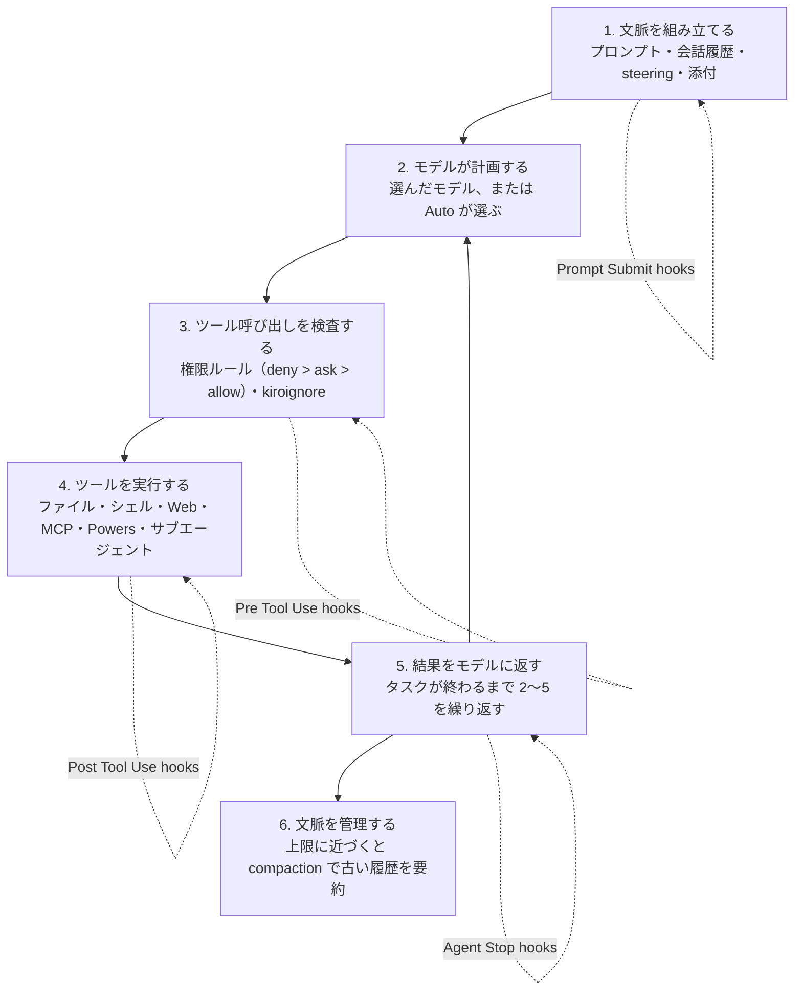

# Kiro とは ― 1 つのエージェント、どこでも同じ

公式ドキュメントは Kiro を次のように定義しています（<https://kiro.dev/llms.txt> 冒頭。本サイトの訳）。

> Kiro は、1 つの統一エージェントハーネスを中心に作られた AI コーディングエージェントで、どの入口でも同じエージェント・同じセッション・同じ設定が使える。Kiro IDE、Kiro CLI、Web、モバイル（iOS）、エージェントのチームを統率する Kiro Crew、そして ACP 対応のあらゆるエディタで使える。

本ページは「How Kiro works」（公式ドキュメント、2026-10-23 更新、<https://kiro.dev/docs/how-kiro-works/>）を土台に、Kiro を初めて知る人向けに全体像を 3 つに分けて説明します。(1) **何をしてくれるか**（ハーネスの 1 ターン）、(2) **何を設定できるか**（機能の一覧）、(3) **設定がどこに置かれ、どこまで効くか**。各機能の詳しい使い方は公式ドキュメントと姉妹サイトに任せ、ここでは 1 行ずつにとどめます。

## 1. 何をしてくれるか ― 1 ターンの 6 段階

Kiro にプロンプトを送ると、どの入口からでも同じループが回ります。公式「How Kiro works」の「Anatomy of a turn」を図にしたものです。

（公式「How Kiro works」の 6 段階を本サイトが図にしたもの）

| 段階 | 何が起きるか | 関わる機能 |
|---|---|---|
| 1 | プロンプト・これまでの会話・steering ファイル・添付したものを集める | [Steering](https://kiro.dev/docs/steering/)、[Prompt Submit hooks](https://kiro.dev/docs/hooks/types/) |
| 2 | 選んだモデルに送る。Auto を選ぶと、タスクに合うモデルを Kiro が選ぶ | [Models](https://kiro.dev/docs/models/) |
| 3 | ツールを動かす前に権限ルールを評価する（deny が ask に、ask が allow に優先）。kiroignore のパターンも見る | [Permissions](https://kiro.dev/docs/permissions/)、[Kiroignore](https://kiro.dev/docs/kiroignore/)、Pre Tool Use hooks |
| 4 | 組み込みツールがファイルを読み書きし、シェルコマンドを実行し、Web を検索する。MCP サーバーと Powers がツールを増やし、サブエージェントが仕事を分担する | [Built-in tools](https://kiro.dev/docs/tools/)、[MCP](https://kiro.dev/docs/mcp/)、[Powers](https://kiro.dev/docs/powers/)、[Sub-agents](https://kiro.dev/docs/custom-agents/subagents/)、Post Tool Use hooks |
| 5 | ツールの出力がモデルに戻り、タスクが終わるまで繰り返す。ターンの終わりに Agent Stop hooks が動く | [Hooks](https://kiro.dev/docs/hooks/) |
| 6 | 会話がモデルの上限に近づくと、古い履歴を要約してセッションを続ける | [Compaction](https://kiro.dev/docs/compaction/) |

公式ドキュメントが強調するのは、**この 6 段階が「1 つのアプリに後付けされた機能」ではなく、ハーネスの各段階だ** という点です。権限ルールを 1 回書けば段階 3 がどの入口でも同じように守られ、steering ファイルを 1 枚書けば段階 1 がどの入口でも同じように整います。

## 2. 何を設定できるか ― ハーネスが持つ機能

公式「How Kiro works」の「What the harness owns」の表に、`llms.txt` の各ページ説明を 1 行ずつ添えたものです（本サイトの訳）。

| 機能 | 1 行で | 公式ページ |
|---|---|---|
| **Specs** | 要件・設計・タスクの 3 つの文書を作ってから実装する、構造化された開発の進め方。機能追加・バグ修正・既存アプリへの追加など複数の型がある | <https://kiro.dev/docs/specs/> |
| **Steering** | プロジェクトの規約・アーキテクチャ・標準を Markdown に書いておき、毎回説明しなくても Kiro が従うようにする | <https://kiro.dev/docs/steering/> |
| **Hooks** | ファイル変更・ツール実行・タスク完了などのイベントで、シェルコマンドやエージェントへの指示を自動実行する | <https://kiro.dev/docs/hooks/> |
| **MCP** | Model Context Protocol。外部サーバーに接続してツール・プロンプト・リソースを増やす。OAuth やツール検索を含む | <https://kiro.dev/docs/mcp/> |
| **Permissions** | 「何をしてよいか」を capability（ファイル読み取り・書き込み・シェル・Web など）ごとにパターンと効果（allow / ask / deny）で宣言する | <https://kiro.dev/docs/permissions/> |
| **Custom agents** | 使えるツール・権限・含める文脈を設定ファイルで定めた専用エージェント。組み込みエージェントと、サブエージェントとしての委譲を含む | <https://kiro.dev/docs/custom-agents/> |
| **Agent Skills** | 指示・スクリプト・テンプレートを束ねた持ち運べる指示パッケージ。オープン標準（Agent Skills）に従い、他ツールと共有できる | <https://kiro.dev/docs/skills/> |
| **Powers** | 特定の技術の知識と MCP サーバーを束ね、関係するキーワードが出たときだけ読み込む | <https://kiro.dev/docs/powers/> |
| **Cloud sessions** | 自分のマシンではなく管理されたクラウドのサンドボックスでセッションを動かし、IDE・CLI・Web・Mobile のどこからでも続ける | <https://kiro.dev/docs/cloud-sessions/> |
| **Memory** | リポジトリのコマンドや規約、修正、デバッグの知見、好みを次のセッションに持ち越す | <https://kiro.dev/docs/memory/> |
| **Compaction** | 長いセッションで古い会話を自動で要約し、目標・決定・進捗を残しながら上限内に収める | <https://kiro.dev/docs/compaction/> |
| **Kiroignore** | gitignore 形式のパターンで、Kiro が触れないファイルを指定する | <https://kiro.dev/docs/kiroignore/> |
| **Checkpoints and rewind** | エージェントの変更を巻き戻す（checkpoints）、会話を前のターンから枝分かれさせる（rewind） | <https://kiro.dev/docs/checkpoints/> |
| **Built-in tools** | ファイル操作・シェル・Web アクセス・コードインテリジェンスなど、ハーネスが備えるツール | <https://kiro.dev/docs/tools/> |
| **Models** | 使えるモデルの一覧、Auto による自動選択、推論の深さ（effort）の調整 | <https://kiro.dev/docs/models/> |
| **Workflows** | 複数のエージェントが段階・ループ・並列で働く再利用可能な手順を、背景で実行する。IDE・CLI・Web で使える | <https://kiro.dev/docs/workflows/> |
| **Local command sandbox** | ローカルで動くシェルコマンドと子プロセスの到達範囲とネットワークを OS の仕組みで制限する | <https://kiro.dev/docs/sandbox/> |
| **ACP** | Agent Client Protocol。Kiro 自身の入口も、JetBrains・Zed などの対応エディタも、同じプロトコルでハーネスに接続する | <https://kiro.dev/docs/acp/> |

公式は「まだすべての機能がすべての入口に届いているわけではない」として、各機能ページの冒頭に **利用できる入口の表（availability table）** を置いています。ある機能が自分の入口で使えるかは、その表で確認してください。

## 3. 設定はどこに置かれ、どこまで効くか

「設定が自分に付いて回る」仕組みの正体は、設定ファイルの置き場所が 4 つのスコープに分かれていることです（公式「How Kiro works」の「Your setup travels with you」）。

| スコープ | 場所 | 誰と一緒に動くか |
|---|---|---|
| **Project** | リポジトリの `.kiro/` | リポジトリと一緒に。チームメイトと、そのリポジトリを開くすべての入口が同じ steering・specs・agents・hooks・MCP サーバーを得る |
| **User** | 自分のマシンの `~/.kiro/` | 自分と一緒に。個人の agents・skills・steering・設定が、ローカルの全プロジェクトで効く |
| **Cloud** | ローカルの `~/.kiro/` を [cloud configuration](https://kiro.dev/docs/web/cloud-configuration/) でアカウントに同期したもの | 自分と一緒に。個人の steering・agents・hooks・skills・Powers・MCP サーバー・workflows がすべてのクラウドセッションで効く |
| **Workspace trust** | `~/.kiro/workspace-roots/<hash>/` | 自分のマシンだけ。プロジェクトごとの権限ルールをリポジトリの外に置くため、clone したリポジトリが自分自身に信頼を与えることはできない |

これが、Kiro Web や Mobile が「設定なしで」プロジェクトの agents と steering を使える理由です。IDE と CLI がローカルで読んでいるのと同じ `.kiro/` をリポジトリから読んでいるからです。優先順位の完全な説明は [Configuration scopes](https://kiro.dev/docs/configuration/) にあります。

## 4. どこで動くか

| 入口 | エージェントが動く場所 |
|---|---|
| IDE・CLI | 既定では自分のマシン。ツールはローカルのファイルシステムとシェルを使い、ローカルのツールチェーンと資格情報でビルドする。[local command sandbox](https://kiro.dev/docs/sandbox/) を有効にするとシェルコマンドを OS の境界の中で動かせる。クラウドセッションを作って参加することもできる |
| Web・Mobile | 管理されたクラウドのサンドボックス。接続したリポジトリを隔離環境に clone して作業し、結果を PR / MR として返す。自分のマシンでは何も実行されず、ラップトップを閉じてもセッションは続く |

クラウドセッションは特定のアプリではなく **アカウント** に属するため、ある入口で始めて別の入口で続けられます（公式「How Kiro works」の「Where the agent runs」）。

## 5. 入口が足すもの

入口は薄い皮ではありません。プラットフォーム側がうまくやれる場面では、入口が自前のツールをハーネスの組み込みツールの代わりに提供できます（例: IDE はファイル操作にエディタの API を使い、エディタ固有のコード解析を足す）。公式「How Kiro works」の「What each surface adds」の表を本サイトが訳したものです。

| 入口 | 足すもの |
|---|---|
| [IDE](https://kiro.dev/docs/ide/) | エディタ統合: インライン差分、checkpoints の UI、spec のペイン、ドッキングできるチャット、`#Problems` でエディタの診断をエージェントに渡す |
| [CLI](https://kiro.dev/docs/cli/) | 端末ネイティブの作業: TUI、スクリプトと CI 向けの headless mode、autocomplete、シェルからのセッション管理 |
| [Web](https://kiro.dev/docs/web/) | 準備なしでブラウザから: サンドボックス実行、リポジトリ接続、PR ベースの納品、スケジュール実行 |
| [Mobile](https://kiro.dev/docs/mobile/) | 外出先から: スマートフォンでセッションを開始・操作 |

どの入口をどんな仕事に使うかは [どのアプリを選ぶか](02_which-app.md) に、「なぜ 1 つのハーネスになったか」は [1 つのエージェント、5 つの入口](../01_story/02_one-agent.md) に書きました。

## 出典

| 出典 | 公開・更新日 |
|---|---|
| [How Kiro works（公式ドキュメント）](https://kiro.dev/docs/how-kiro-works/) | 2026-10-23 |
| [llms.txt（公式ドキュメント索引。各ページの説明文）](https://kiro.dev/llms.txt) | — |
| [Configuration scopes](https://kiro.dev/docs/configuration/) | 2026-10-21 |
| [Workflows](https://kiro.dev/docs/workflows/) | 2026-10-31 |
| [Local command sandbox](https://kiro.dev/docs/sandbox/) | 2026-10-29 |
| [Agent Client Protocol (ACP)](https://kiro.dev/docs/acp/) | 2026-10-01 |
| [Memory](https://kiro.dev/docs/memory/) | 2026-10-29 |

## 次に読む <!-- sources: n/a -->

- [どのアプリを選ぶか](02_which-app.md)
- [はじめ方 ― Kiro CLI を 3 ステップで](03_get-started.md)
- [用語集](../03_reference/02_glossary.md)
