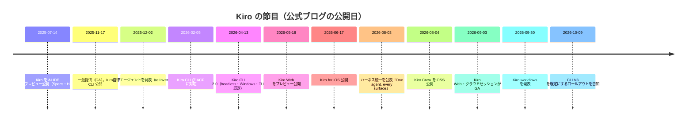

# Kiro の年表 ― 節目の記事だけを選んで

Kiro は 2025-07-14 に「AI IDE」としてプレビュー公開され、約 15 か月で IDE・CLI・Web・Mobile・Crew の 5 つの入口を持つ「1 つのエージェント」になりました。本ページは公式ブログ全 113 本（2025-07-14〜2026-10-30 公開分）から **節目になる 30 本** を選び、各記事の要旨を 1〜2 行で書いたものです。全記事の一覧（必読度と 1〜2 行の内容説明つき）は [公式ブログ索引](../03_reference/01_blog-index.md) にあります。

（図は公式ブログの公開日をもとに本サイトが作成）

## 2025 年 7 月〜10 月 ― 誕生とプレビュー

| 公開日 | 記事 | 要旨 |
|---|---|---|
| 2025-07-14 | [Introducing Kiro](https://kiro.dev/blog/introducing-kiro/) | 「プロンプトで動くものはできるが、本番に持っていくには足りない」という問題意識から、**Specs**（要件・設計・タスクを文書にしてから実装する）と **Hooks**（イベントで自動実行する処理）を中核にした AI IDE として発表。待機リスト制のプレビュー |
| 2025-07-24 | [This is fine... (really)](https://kiro.dev/blog/this-is-fine-really/) | 公開から 1 週間で 10 万人超が利用し、待機リストにさらに多くの人が並んだ。需要に対する対応状況の報告 |
| 2025-09-15 | [Announcing new pricing plans and Auto, our new agent](https://kiro.dev/blog/new-pricing-plans-and-auto/) | 「vibe」「spec」で分かれていた上限を **1 つのクレジットプール** に統合。タスクごとに最適なモデルを自動で選ぶ **Auto** エージェントを発表 |
| 2025-10-16 | [The wait(list) is over](https://kiro.dev/blog/waitlist-is-over/) | 公開 90 日で待機リストを廃止。新規ユーザーに期間限定で 500 ボーナスクレジット |

## 2025 年 11 月〜12 月 ― GA と Kiro CLI

| 公開日 | 記事 | 要旨 |
|---|---|---|
| 2025-11-17 | [Kiro is generally available](https://kiro.dev/blog/general-availability/) | 一般提供（GA）。property-based testing・checkpointing・multi-root workspace・**Kiro CLI**・チームプランを同時発表。公式は「spec-driven development を AI コーディングツールに最初に持ち込んだ」と述べている |
| 2025-11-17 | [Bring Kiro agents to your terminal with Kiro CLI](https://kiro.dev/blog/introducing-kiro-cli/) | Amazon Q Developer CLI のエージェント技術（agent mode・MCP・steering・custom agents）を引き継いだ **Kiro CLI** を公開。`.kiro` の設定を IDE と共用できる。詳細は [Kiro CLI の道](03_cli-journey.md) |
| 2025-11-17 | [Does your code match your spec?](https://kiro.dev/blog/property-based-testing/) | 仕様から性質（property）を取り出し、多数のランダム入力で検証する **property-based testing** を Specs に組み込んだ理由。単体テストが仕様を正しく写しているか確かめる「鶏と卵」問題への答え |
| 2025-12-02 | [Introducing Kiro autonomous agent](https://kiro.dev/blog/introducing-kiro-autonomous-agent/) | re:Invent で、人が付き添わずに文脈を保ちながら自律的に働く「frontier agent」の構想を発表。のちに Kiro Web の autonomous mode として提供（記事冒頭の追記） |
| 2025-12-03 | [Introducing Kiro powers](https://kiro.dev/blog/introducing-powers/) | フレームワークの知識と MCP サーバーを束ね、必要なときだけ読み込む **Powers**。MCP サーバーを 5 つ接続すると 100 以上のツール定義でコンテキストが埋まる、という問題への対処 |

## 2026 年 1 月〜4 月 ― エディタの外へ、端末の進化

| 公開日 | 記事 | 要旨 |
|---|---|---|
| 2026-02-05 | [Kiro 0.9: Custom subagents in the IDE, new enterprise controls, and granular code review](https://kiro.dev/blog/custom-subagents-skills-and-enterprise-controls/) | IDE に **custom subagents**（用途別に道具と文脈を絞った子エージェント）と **skills** 対応を追加。企業向けの統制機能も |
| 2026-02-05 | [Specialized IDEs deserve AI too: Kiro adopts ACP](https://kiro.dev/blog/kiro-adopts-acp/) | Kiro CLI が **Agent Client Protocol（ACP）** に対応し、JetBrains IDE・Zed・Emacs・Neovim などから Kiro のエージェントを使えるようになった |
| 2026-02-18 | [Kiro loves regulated workloads](https://kiro.dev/blog/introducing-govcloud/) | **AWS GovCloud (US)** リージョンで Kiro を提供。公共部門など規制環境の開発者向け |
| 2026-03-23 | [A new look for the Kiro CLI](https://kiro.dev/blog/new-look-for-cli/) | `kiro-cli --tui` で新しい端末 UI を実験提供。サブエージェントや複数エージェントの時代に、1 行ずつ流す表示では足りないという判断 |
| 2026-04-13 | [Kiro CLI 2.0](https://kiro.dev/blog/cli-2-0/) | **headless mode**（API キーで CI/CD から実行）、**Windows ネイティブ対応**、**TUI を既定** に。解説記事は [introducing headless mode](https://kiro.dev/blog/introducing-headless-mode/) |
| 2026-04-16 | [Root cause in 33 seconds](https://kiro.dev/blog/root-cause-in-33s/) | EC2 チームが Kiro CLI で社内ビルドの性能劣化を 33 秒で原因特定し、月あたり約 4 年分の計算時間を削減した事例 |
| 2026-04-23 | [Build with Kiro: Introducing the community hub and Kiro Labs](https://kiro.dev/blog/introducing-community-and-labs/) | コミュニティハブと、Amazon 社員が Kiro で・Kiro のために作った OSS を集める GitHub 組織 **Kiro Labs** を開設 |

## 2026 年 5 月〜7 月 ― クラウドとモバイル

| 公開日 | 記事 | 要旨 |
|---|---|---|
| 2026-05-18 | [Introducing Kiro Web](https://kiro.dev/blog/introducing-kiro-web/) | **Kiro Web** を有料プラン向けにプレビュー公開。「自律性は別製品ではなく Kiro の中核に属する」として、re:Invent の自律エージェント構想を Web から実装 |
| 2026-06-17 | [Introducing Kiro for iOS](https://kiro.dev/blog/introducing-kiro-for-ios/) | **iOS アプリ** を公開。クラウドセッションの開始・監視・差分確認・承認を、ラップトップなしで行える。chat・spec・autonomy の 3 モード |
| 2026-06-18 | [Introducing automations in Kiro on the web](https://kiro.dev/blog/introducing-automations/) | Kiro Web に **automations**（スケジュール実行）を追加。繰り返しの保守作業を自律セッションとして定期実行し、PR を自動で開く |
| 2026-06-25 | [Introducing Agent Focus](https://kiro.dev/blog/introducing-agent-focus/) | IDE に **Agent Focus**（複数のエージェントセッションを並べて指揮する表示）を実験追加。コード中心の表示と行き来できる |
| 2026-07-14 | [One year of Kiro](https://kiro.dev/blog/one-year/) | 1 周年の回顧。「developers deserve better than vibe coding」という出発点、最初の 5 日で 10 万人超、10 月までに倍増 |

## 2026 年 8 月〜10 月 ― 1 つのエージェント、5 つの入口

| 公開日 | 記事 | 要旨 |
|---|---|---|
| 2026-08-03 | [One agent, every surface: how we built the Kiro agent harness](https://kiro.dev/blog/one-agent/) | IDE（TypeScript）・CLI（Rust）・Web（Python）で別々だったエージェント本体を **1 つのハーネス** に統一した経緯と設計判断。本サイトの中核。詳細は [1 つのエージェント、5 つの入口](02_one-agent.md) |
| 2026-08-04 | [Introducing Kiro Crew](https://kiro.dev/blog/introducing-kiro-crew/) | 社内プロジェクト MeshClaw として生まれ、6 か月弱で 39,000 人超の Amazon の builder が使った **Kiro Crew** を OSS 公開。詳細は [Kiro Crew の起源](04_crew-origin.md) |
| 2026-08-12 | [Which Kiro app should I pick?](https://kiro.dev/blog/which-kiro-app-should-i-pick/) | 5 つの入口の選び方を「どれを選ぶかではなく、この仕事にはどれか」と整理。詳細は [どのアプリを選ぶか](../00_start/02_which-app.md) |
| 2026-08-18 | [Close the laptop, keep the agent: building with cloud sessions](https://kiro.dev/blog/cloud-sessions/) | **クラウドセッション** をプレビュー公開。Web だけでなく CLI（`--cloud`）・IDE からもクラウドのサンドボックスでエージェントを動かし、どの入口からでも続きができる |
| 2026-09-03 | [Agentic engineering in the cloud](https://kiro.dev/blog/agentic-engineering-in-the-cloud/) | **Kiro Web・クラウドセッションが GA**。ローカルの `~/.kiro/` 設定をクラウドセッションにも効かせる **cloud configuration** を同時に提供 |
| 2026-09-30 | [Introducing Kiro workflows](https://kiro.dev/blog/introducing-workflows/) | 複数のエージェントが段階・ループ・並列で働く手順（**workflows**）を Kiro の実行基盤が進める仕組み。Kiro 自身の開発（cloud configuration・cloud sessions・workflows 自体）に使ったと記事は述べている |
| 2026-10-09 | [Kiro CLI V3 is rolling out as the default experience](https://kiro.dev/blog/cli-3/) | 統一ハーネス（V3）を CLI の既定にするロールアウトを 10-12 から開始すると告知。CLI 3.0 を「10 月末まで」に公開予定とした。公式 changelog での 3.0 掲載は本サイトが確認できた時点では無く、[Kiro CLI の道](03_cli-journey.md) で現在の状態を追っている |
| 2026-10-14 | [Local sandboxing in Kiro](https://kiro.dev/blog/local-sandboxing/) | IDE・CLI で **ローカルサンドボックス** が GA。エージェントが実行するコマンドの到達範囲を OS の仕組みで制限し、`~/.aws` などをシェル経由で読まれる抜け道を塞ぐ |
| 2026-10-20 | [Introducing memory in Kiro IDE and CLI](https://kiro.dev/blog/memory-in-ide-cli/) | **memory** を IDE・CLI に追加。作業中に現れた修正・好み・デバッグの知見を保存し、次のセッションに持ち越す |

## 選び方について <!-- sources: n/a -->

- 選定の基準は「製品・サーフェスの公開」「ハーネス統一に関わる設計判断」「Kiro CLI の節目」の 3 つです。モデル追加（16 本）・料金（17 本）の記事は年表に入れていません。これらは [公式ブログ索引](../03_reference/01_blog-index.md) の分類タグと必読度で探せます。
- 要旨は本サイトが公式記事を読んで自分の言葉で書いたものです。数値（利用者数・削減時間など）は記事の記載どおりです。

## 出典

本ページの出典は表中の各記事（<https://kiro.dev/blog/>）です。公開日は各記事ページの表示日です。

## 次に読む <!-- sources: n/a -->

- [1 つのエージェント、5 つの入口 ― Kiro がハーネスを統一した話](02_one-agent.md)
- [Kiro CLI の道 ― Amazon Q Developer CLI から V3 へ](03_cli-journey.md)
- [Kiro Crew の起源 ― MeshClaw から software factory へ](04_crew-origin.md)
- [公式ブログ索引（全 113 本）](../03_reference/01_blog-index.md)
