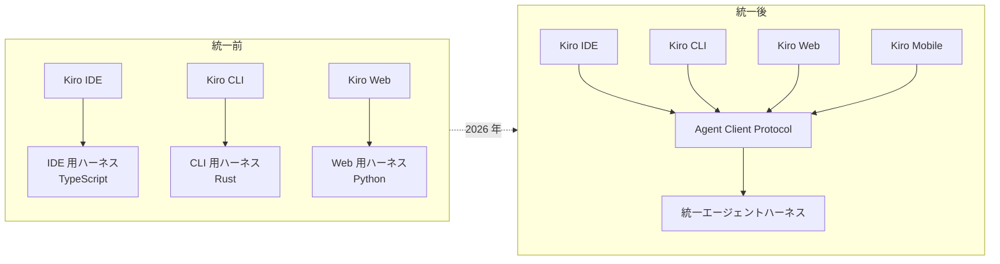

# 1 つのエージェント、5 つの入口 ― Kiro がハーネスを統一した話

Kiro の IDE・CLI・Web・Mobile は、見た目は別のアプリですが、中で動いている「エージェント本体」は 1 つです。公式はこれを **unified agent harness（統一エージェントハーネス）** と呼んでいます。本ページは、なぜ 1 つにしたのか、何が変わったのかを、公式ブログと公式ドキュメントに基づいてまとめます。

## 読者にとっての意味 ― 設定が自分に付いて回る

公式ドキュメント「How Kiro works」（更新 2026-10-23）は、この仕組みを「Kiro is one agent, available everywhere you work.」と要約しています（<https://kiro.dev/docs/how-kiro-works/>）。使う側にとって大事なのは次の 3 点です。

| 変わること | 具体例（公式ドキュメントの説明） |
|---|---|
| **同じ設定が、どの入口でも効く** | プロジェクトの `.kiro/` に置いた steering・custom agents・hooks・MCP 設定は、IDE・CLI・Web のどれで開いても同じように読まれる。`permissions.yaml` も CLI と IDE で同じファイルを参照する |
| **同じ振る舞いになる** | 権限ルールの拒否、steering の効き方、長い会話の圧縮（compaction）が、入口によって変わらない |
| **セッションが場所を越える** | ラップトップを閉じてもクラウドセッションは動き続け、スマートフォンから様子を見て、翌朝 IDE で続きを拾える。公式はこれを設計の出発点に置いている |

公式の表（How Kiro works「Your setup travels with you」）では、設定の置き場所が 4 つのスコープに整理されています。

| スコープ | 場所 | 付いて回る相手 |
|---|---|---|
| Project | リポジトリの `.kiro/` | そのリポジトリを開くチームメイトと、すべての入口 |
| User | 自分のマシンの `~/.kiro/` | 自分（ローカルの全プロジェクト） |
| Cloud | `~/.kiro/` の設定をアカウントに同期（cloud configuration） | 自分（すべてのクラウドセッション） |
| Workspace trust | `~/.kiro/workspace-roots/<hash>/` | 自分のマシンだけ（クローンしたリポジトリが勝手に信頼を得られない） |

## なぜ 1 つにしたのか ― 3 つに分かれていた時代

2026-08-03 の公式ブログ「One agent, every surface: how we built the Kiro agent harness」（<https://kiro.dev/blog/one-agent/>）は、統一前の状態をこう説明しています。

- 当初は **各クライアントが別々のハーネスを持っていた**。IDE チームは TypeScript（Code OSS 拡張に合わせる）、CLI チームは Rust（性能）、Web チームは Python（最新のエージェント研究に近い）で、それぞれ自分たちの実装を作った。
- 速く試すには良かったが、違いが積み上がった。セッションの保存形式が違う。**権限の構文が互換性を持たない**（CLI は正規表現の `allowedCommands`/`deniedCommands`、IDE は前方一致の `trustedCommands` と部分一致の拒否リスト）。compaction の方針も、サブエージェントの文脈共有も、custom agents の仕組みも違う。
- 機能も分裂した。**Specs と Powers は IDE だけ、plan mode と code intelligence は CLI だけ** にあった。
- 結果として、新機能は 3 回作り、バグは 3 回直すことになった。公式はこの状態を「Every new capability had to be built and maintained three times」と書いています。
- 転換点は **Kiro Web の公開準備** でした。Web 用に 4 つ目のハーネスを作って費用を積み増すのではなく、3 チームが学んだ最良の部分を 1 つのハーネスにまとめる判断をした、と記事は述べています。

（図は公式ブログ・公式ドキュメントの説明をもとに本サイトが作成）

## 統一して何が起きたか

同じ記事と、2026-10-09 の公式ブログ「Kiro CLI V3 is rolling out as the default experience」（<https://kiro.dev/blog/cli-3/>）が挙げる成果です。

- **1 つの入口に閉じていた機能が全部に来た。** Specs（要件・設計・タスク）は IDE 専用から CLI（`/spec new`）と Web へ。custom agents は `.kiro/agents/` の Markdown 形式で全入口共通。hooks は `.kiro/hooks/*.json` で同じトリガー・同じ振る舞い。
- **ハーネス側の改善が、アプリを更新せずに全入口へ届く。** 例として global hooks（`~/.kiro/hooks/` に置けば全ワークスペースで発火）と policy presets（`dev-shell`・`edit-workspace` のような名前付きルール集）は、クライアント側の変更ゼロで全入口に出荷された、と記事は述べています。
- **権限が 1 つの言語になった。** capability（`fs_read`・`fs_write`・`shell`・`web_fetch`・`mcp`・`subagent` など）単位で、1 行のルールがそのカテゴリの全ツールに効く。ルールは複数スコープで合成され、拒否が常に優先される。
- **compaction・再試行・MCP 接続の改善が一度で全入口に効く。** 以前は入口ごとに長い会話の振る舞いが違ったが、実装が 1 つになった。
- この統一作業自体を **Kiro で行った** と記事は書いています（「built, naturally, using Kiro itself」）。

## 例外もある ― Kiro Crew

2026-08-12 の公式ブログ「Which Kiro app should I pick?」（<https://kiro.dev/blog/which-kiro-app-should-i-pick/>）は、Kiro Crew を「app と呼ぶのは控えめすぎる」と評し、常時稼働の自動化・複数エージェントの統率・セッションをまたぐ記憶の多くが **Crew 自身に実装されていて、共有ハーネスの機能と一部重なる** と認めています。出荷を優先してアーキテクチャの原則から意図的に外れた判断で、後で共有アーキテクチャに揃える計画だと述べています。

Crew の生い立ち（社内プロジェクト MeshClaw からの OSS 化）は、拡充ページで扱う予定です。

## どう作ったか ― 技術的な判断

設計の詳細（公式ブログ「One agent, every surface」より）

- **ライブラリではなく独立プロセス。** 共有ライブラリでは境界が弱く、クライアントが内部メソッドを呼び始めて再び分岐する、と過去の試みから学んだ。独立プロセスなら言語もランタイムも揃える必要がなく、ラップトップでもクラウドの VM でも同じバイナリが動く。
- **境界は Agent Client Protocol（ACP）。** ACP は 2026 年 6 月に 1.0 に達した標準仕様で、JetBrains・Xcode・Zed・Obsidian・Emacs・Neovim などが対応する。Kiro は自分のクライアントと自分のハーネスの間にも ACP を使い、live steering・Specs・権限 UI・文脈使用量などは `_kiro/` 名前空間の拡張メソッドで足している。
- **トランスポートは 2 種類。** ローカルクライアントは stdio、Web と iOS は独自の WebSocket トランスポートでクラウドのサンドボックス内ハーネスに接続する。バイナリ・ツール・振る舞いは同じ。
- **クライアントは自前のツールで置き換えられる。** IDE は Code OSS の API でファイルを扱うため、ハーネス内蔵のファイル読み書きツールを自分のツールで差し替える。
- **権限は Cedar に裏打ちされた capability モデル。** Cedar は形式検証されたポリシー言語で、ルールは deny-always-wins で合成される。エージェントが自分の権限ファイルを書き換えられないなどの不変条件をハーネスが強制する。

ハーネスがプロンプト 1 回ごとに回す 6 段階（文脈の組み立て → モデル → 権限評価 → ツール実行 → 結果の反映 → compaction）は、公式ドキュメント「How Kiro works」の「Anatomy of a turn」に図解があります（<https://kiro.dev/docs/how-kiro-works/>）。

## 出典

| 出典 | 公開・更新日 |
|---|---|
| [One agent, every surface: how we built the Kiro agent harness](https://kiro.dev/blog/one-agent/) | 2026-08-03 |
| [Which Kiro app should I pick?](https://kiro.dev/blog/which-kiro-app-should-i-pick/) | 2026-08-12 |
| [Kiro CLI V3 is rolling out as the default experience](https://kiro.dev/blog/cli-3/) | 2026-10-09 |
| [How Kiro works](https://kiro.dev/docs/how-kiro-works/) | 2026-10-23 |

## 次に読む <!-- sources: n/a -->

- [Kiro CLI の道 ― Amazon Q Developer CLI から V3 へ](03_cli-journey.md)
- [なぜ筆者は Kiro CLI が好きなのか](../02_why-kiro-cli/01_why-i-love-kiro-cli.md)
- [はじめ方](../00_start/03_get-started.md)
