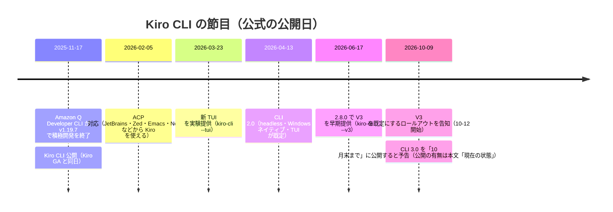

# Kiro CLI の道 ― Amazon Q Developer CLI から V3 へ

Kiro CLI は、2025-11-17 に Amazon Q Developer CLI の技術を引き継いで生まれ、約 1 年で「別の見た目の CLI」から「Kiro IDE・Kiro Web と同じエージェント本体を端末で動かすクライアント」へ変わりました。本ページは、その節目を公式ブログ・公式 changelog・公式リポジトリの告知に基づいて追います。

**出典**（公開日・更新日は公式ページの表示日）:

| 出典 | 公開・更新日 |
|---|---|
| [aws/amazon-q-developer-cli README・Releases](https://github.com/aws/amazon-q-developer-cli) | v1.19.7: 2025-11-17 |
| [Bring Kiro agents to your terminal with Kiro CLI](https://kiro.dev/blog/introducing-kiro-cli/) | 2025-11-17 |
| [Kiro is generally available](https://kiro.dev/blog/general-availability/) | 2025-11-17 |
| [Specialized IDEs deserve AI too: Kiro adopts ACP](https://kiro.dev/blog/kiro-adopts-acp/) | 2026-02-05 |
| [A new look for the Kiro CLI](https://kiro.dev/blog/new-look-for-cli/) | 2026-03-23 |
| [Planview saves 40+ hours per audit cycle](https://kiro.dev/blog/automating-soc-2-compliance/) | 2026-04-10 |
| [Kiro CLI 2.0](https://kiro.dev/blog/cli-2-0/)・[introducing headless mode](https://kiro.dev/blog/introducing-headless-mode/) | 2026-04-13 |
| [Root cause in 33 seconds](https://kiro.dev/blog/root-cause-in-33s/) | 2026-04-16 |
| [Changelog CLI 2.8: CLI v3 Early Access](https://kiro.dev/changelog/cli/2-8/) | 2026-06-17 |
| [Which Kiro app should I pick?](https://kiro.dev/blog/which-kiro-app-should-i-pick/) | 2026-08-12 |
| [Kiro CLI V3 is rolling out as the default experience](https://kiro.dev/blog/cli-3/) | 2026-10-09 |
| [Changelog CLI 2.36](https://kiro.dev/changelog/cli/2-36/) | 2026-10-29 |
| [What's new in CLI V3（公式ドキュメント）](https://kiro.dev/docs/cli/v3/) | 2026-10-31 |

---

## 📑 このページの内容
<!-- sources: n/a -->

1. [前史 ― Amazon Q Developer CLI の終わりと Kiro CLI の始まり](#前史--amazon-q-developer-cli-の終わりと-kiro-cli-の始まり)
2. [2026 年前半 ― 端末の外へ、そして新しい顔](#2026-年前半--端末の外へそして新しい顔)
3. [2026 年 6 月 ― V3 早期提供: 同じハーネスが端末に来た](#2026-年-6-月--v3-早期提供-同じハーネスが端末に来た)
4. [2026 年 10 月 ― V3 が既定に](#2026-年-10-月--v3-が既定に)
5. [導入事例 ― 公式ブログが紹介した 2 件（年表の外）](#導入事例--公式ブログが紹介した-2-件年表の外)
6. [公式ドキュメントで確かめる](#公式ドキュメントで確かめる)

（図は公式の公開日をもとに本サイトが作成）

## 前史 ― Amazon Q Developer CLI の終わりと Kiro CLI の始まり

Kiro CLI の前身は Amazon Q Developer CLI（Q CLI）です。公式リポジトリ `aws/amazon-q-developer-cli` の README は、このプロジェクトが積極的な保守を終え、重要なセキュリティ修正のみを受けること、そして Kiro CLI がクローズドソース製品として提供されることを告知しています（原文: 「no longer being actively maintained and will only receive critical security fixes」<https://github.com/aws/amazon-q-developer-cli>）。最終リリース v1.19.7 の公開日は 2025-11-17 です（<https://github.com/aws/amazon-q-developer-cli/releases/tag/v1.19.7>）。

同じ 2025-11-17、Kiro は一般提供（GA）になり、Kiro CLI が公開されました。公式ブログ「Bring Kiro agents to your terminal with Kiro CLI」（<https://kiro.dev/blog/introducing-kiro-cli/>）は、Kiro CLI が Q Developer CLI のエージェント機能（agent mode・MCP・steering・custom agents）を引き継ぎ、ソーシャルログイン・Claude Haiku 4.5・Auto エージェント（タスクごとに最適なモデルを自動で選ぶ仕組み）を足したものだと説明しています。この時点ですでに、`.kiro` フォルダの設定（steering・MCP）が IDE と CLI で共用できることが売りでした。GA 発表（<https://kiro.dev/blog/general-availability/>）では、property-based testing（仕様から性質を取り出し多数のランダム入力で検証するテスト）・checkpointing（エージェントの変更を巻き戻す機能）・multi-root workspace（複数のプロジェクトルートを 1 つのワークスペースで扱う）と並ぶ 4 本柱の 1 つとして CLI が紹介されています。

## 2026 年前半 ― 端末の外へ、そして新しい顔

- **ACP 対応（2026-02-05）**: 公式ブログ「Specialized IDEs deserve AI too: Kiro adopts ACP」（<https://kiro.dev/blog/kiro-adopts-acp/>）。Kiro CLI が Agent Client Protocol に対応し、JetBrains IDE・Zed・Emacs・Neovim・Eclipse などの ACP 対応エディタから Kiro のエージェントを使えるようになりました。記事では JetBrains DataGrip から Kiro を使う例が示されています。ACP はのちに Kiro 自身のクライアントとハーネスの境界にも採用されます（[ハーネス統一の話](02_one-agent.md)）。
- **新しい TUI（2026-03-23）**: 公式ブログ「A new look for the Kiro CLI」（<https://kiro.dev/blog/new-look-for-cli/>）。1 行ずつ出力する従来の方式では、サブエージェントや複数エージェントの時代に限界があるとして、`kiro-cli --tui` で新しい端末 UI（TUI = Terminal User Interface。画面全体を使う対話表示）を実験提供。常時使える入力欄、`/` コマンドと `@` コンテキストのドロップダウン、ツール実行状況のライブ表示が特徴です。記事は「We love the terminal.」の一文で始まります。
- **CLI 2.0（2026-04-13）**: 公式ブログ「Kiro CLI 2.0」（<https://kiro.dev/blog/cli-2-0/>）。(1) **headless mode**（人が対話しない実行モード）: API キーを環境変数 `KIRO_API_KEY` に置けばブラウザなしで動き、CI/CD パイプラインに組み込める（解説記事 <https://kiro.dev/blog/introducing-headless-mode/>）(2) **Windows ネイティブ対応**（WSL 不要）(3) **TUI が既定**（`kiro-cli --classic` で従来表示に戻せる）。

## 2026 年 6 月 ― V3 早期提供: 同じハーネスが端末に来た

公式 changelog 2.8.0（2026-06-17、<https://kiro.dev/changelog/cli/2-8/>）が V3 の早期提供を告知しました。既存の 2.x と並行して動き、`kiro-cli --v3` で opt-in します。changelog は、Kiro CLI 3.0 が Kiro IDE・Kiro Web と同じ統一ハーネス上に構築されること、端末での Specs・capability ベースの権限・独立ファイル形式の hooks・タグ指定のエージェント設定が V3 で入ることを挙げています。

公式ドキュメント「What's new in CLI V3」（<https://kiro.dev/docs/cli/v3/>）は、V2 と V3 の対応表、移行手順、V3 だけにある機能（Kiro 自身の機能を公式ドキュメントに基づいて答える Introspect サブエージェント、会話を枝分かれさせて戻れる `/tangent`）を載せています。**V3 はハーネスの世代（V2 = 従来のハーネス、V3 = 統一ハーネス）、3.0 は CLI の版番号**です。

> ⚠️ **公式の記述に食い違いがあります。** 公式ドキュメント「What's new in CLI V3」（更新日 2026-10-31）は冒頭で V3 を「early release」と呼び、`kiro-cli --v3` で opt-in するまで既存の 2.x の設定は変わらないと書いています。一方、公式ブログ（2026-10-09）は V3 を「既定の体験」としてロールアウトすると告知しています（次節）。更新日は docs の方が新しいため、本サイトは「ロールアウトは段階的で、起動時のプロンプトで切り替えを促す段階にある。opt-in の `--v3` も引き続き有効」と読み、CLI 3.0 の公開（V3 が唯一のハーネスになる時点）とは区別して書いています。

## 2026 年 10 月 ― V3 が既定に

2026-10-09 の公式ブログ「Kiro CLI V3 is rolling out as the default experience」（<https://kiro.dev/blog/cli-3/>）の要点です。

| 項目 | 内容 |
|---|---|
| ロールアウト | 2026-10-12 から、起動時に V3 への切り替えを促すプロンプトを段階的に表示。「Switch to V3 and upgrade my configs」「Remind me later」「Don't ask again」の 3 択。**Don't ask again は V2 に留まる選択ではなく**、CLI 3.0 公開時に V3 へ移る |
| CLI 3.0 | 「by the end of October」に公開予定と記事は述べている（下の「現在の状態」参照） |
| V3 で使えるもの | クラウドセッション（`kiro-cli --cloud`。クラウドの隔離環境でエージェントが動き、ラップトップを閉じても作業が続く。us-east-1 のみ）、memory（`/memories`。セッションを越えて文脈を覚える）、Specs（`/spec new`）、`/tangent` の復活、`/sessions` パネル（セッションの一覧・検索・名前付け）、workflows（複数エージェントの手順を背景で実行。opt-in）、global hooks（`~/.kiro/hooks/` に置けば全ワークスペースで発火）、サブディレクトリごとの `AGENTS.md`（部分ごとの指示ファイル） |
| 廃止 | inline shell autocomplete、CLI desktop app、Classic（非 TUI）表示。新機能は TUI に集中する |
| 移行 | custom agents は `.json.bak` にバックアップして「universal config」形式（V2 の設定を保ちつつ V3 の設定を加えた形式）へ自動変換。変換できない hooks は警告。`/upgrade-agent`・`kiro-cli agent upgrade <dir>`（2.29 以降・`--dry-run` あり）。権限は V2 の信頼ツール一覧から V3 の「アクションとリソースへのルール」へ（deny > ask > allow）。V2 専用だった `use_aws` ツールは廃止され、AWS CLI はシェルツール経由 |
| 戻り方 | `kiro-cli --v2`（その起動のみ）。V2 のセッションは V3 で再開できるが、逆は不可 |

### 現在の状態（公式 changelog の実測）

公式 changelog（<https://kiro.dev/changelog/cli/>）の最新系列は **2.36（2.36.0・2026-10-29）** で、3.0 系列のページはまだありません。したがって本ページでは CLI 3.0 を「2026-10-09 のブログで予告されたもの」として扱い、公開が確認できた時点で更新します。2.36.0 では、V3 セッションで日常的な操作を Kiro が代わりに承認する「Approve for me」や、ACP 経由で使うときのハーネス世代（v1・v2・v3）を選ぶ `acp.agentEngine` 設定が追加されています（<https://kiro.dev/changelog/cli/2-36/>）。

## 導入事例 ― 公式ブログが紹介した 2 件（年表の外）

- **EC2 チーム「Root cause in 33 seconds」（2026-04-16）**: 社内ビルドの性能劣化を Kiro CLI が 33 秒で調査・原因特定・修正し、381 パッケージ・月 55 万回のビルドで月あたり約 4 年分の計算時間を削減したと報告しています。コード生成ではなく、見慣れないコードベースを横断する根本原因分析に「より汎用的なエージェント」を選んだ、という理由が書かれています（<https://kiro.dev/blog/root-cause-in-33s/>）。
- **Planview「SOC 2 compliance」（2026-04-10）**: SOC 2 の監査サイクルあたり 40 時間以上を、Kiro CLI で証跡収集を自動化して削減した事例です（Planview は 3,000 社超に提供するポートフォリオ管理ベンダー）（<https://kiro.dev/blog/automating-soc-2-compliance/>）。

## 公式ドキュメントで確かめる

| 知りたいこと | 公式ページ |
|---|---|
| CLI 全体 | <https://kiro.dev/docs/cli/> |
| V3 の変更点と移行 | <https://kiro.dev/docs/cli/v3/> |
| 版ごとの変更 | <https://kiro.dev/changelog/cli/> |
| V2 時代から全版の日本語解説 | [猫でもわかるKiro CLI アップデート情報](https://github.com/kamogashira-sys/q-cli-docs)（姉妹サイト） |

## 次に読む
<!-- sources: n/a -->

- [1 つのエージェント、5 つの入口](02_one-agent.md)
- [なぜ筆者は Kiro CLI が好きなのか](../02_why-kiro-cli/01_why-i-love-kiro-cli.md)
- [はじめ方](../00_start/03_get-started.md)
