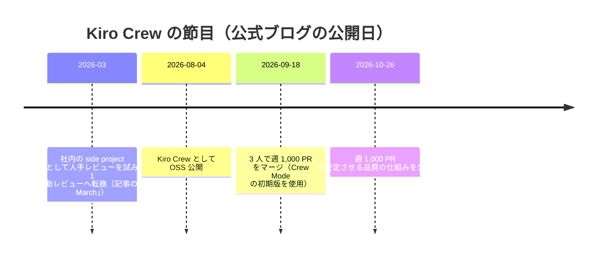

# Kiro Crew の起源 ― MeshClaw から software factory へ

Kiro Crew は、Kiro の 5 つの入口のうち唯一の **オープンソース** で、唯一「ハーネス統一の原則から意図的に外れて出荷された」ものです。本ページは、Amazon 社内の side project として生まれてから、3 人のエンジニアが週 1,000 PR をマージする「software factory」になるまでを、公式ブログ 4 本と公式ドキュメントに基づいて追います。

**出典**（公開日・更新日は公式ページの表示日）:

| 出典 | 公開・更新日 |
|---|---|
| [Introducing Kiro Crew](https://kiro.dev/blog/introducing-kiro-crew/) | 2026-08-04 |
| [Which Kiro app should I pick?](https://kiro.dev/blog/which-kiro-app-should-i-pick/) | 2026-08-12 |
| [How we built a software factory with Kiro Crew to merge 1,000 PRs in a week](https://kiro.dev/blog/software-factory-1000-prs/) | 2026-09-18 |
| [Keeping a software factory stable at 1,000 PRs a week](https://kiro.dev/blog/software-factory-stability/) | 2026-10-26 |
| [Crew Quick start（公式ドキュメント）](https://kiro.dev/docs/crew/) | 2026-10-20 |
| [kiro.dev/crew（製品ページ）](https://kiro.dev/crew/) | — |

---

## 📑 このページの内容
<!-- sources: n/a -->

1. [社内の side project「MeshClaw」](#社内の-side-projectmeshclaw)
2. [2026-08-04 ― OSS 公開](#2026-08-04--oss-公開)
3. [なぜ「原則から外れて」出荷したのか](#なぜ原則から外れて出荷したのか)
4. [2026-09-18 ― 3 人で週 1,000 PR](#2026-09-18--3-人で週-1000-pr)
5. [2026-10-26 ― 週 1,000 PR を壊さずに続ける](#2026-10-26--週-1000-pr-を壊さずに続ける)
6. [公式ドキュメントで確かめる](#公式ドキュメントで確かめる)

（図は公式ブログの公開日をもとに本サイトが作成。「2026-03」は 2026-10-26 の記事が「In early March」と述べていることに基づき月単位でのみ示しています。MeshClaw の開発開始日は公式に記載がなく未確認です）

## 社内の side project「MeshClaw」

公式ブログ「Introducing Kiro Crew」（2026-08-04、<https://kiro.dev/blog/introducing-kiro-crew/>）によると、Kiro Crew は Amazon 社内の side project **MeshClaw** として始まりました。作者は Bolin Chen・Zejiang (Joe) Guo・Zezhen Xu の 3 人です。

- **動機**: タスクを投げて席を離れ、戻ったら確認に値する結果ができていること。1 つのプロンプトに付き添うのではなく、複数のタスクを同時に走らせること。社内にはそれがなかった
- **着想**: OpenClaw など自己学習エージェントの流れに刺激を受けたが、社内開発のセキュリティ要件を満たす必要があった
- **土台**: 普段使いの道具だった Kiro CLI を介して **Kiro のハーネスの上に** 作るのが自然だった

まず自分たち用に作り、ほかの Amazon の builder が使い始め、各自が自分のワークフローの隙間を埋める部品を足していった。記事はその結果を「6 か月弱で 39,000 人超の Amazon の builder が採用し、nearly 500 contributors が 597 回の更新を週平均 143 コミットのペースで出した」と書いています。この「貢献が積み重なった」ことが OSS 公開の決め手だった、というのが記事の説明です。

## 2026-08-04 ― OSS 公開

同じ記事は、公開時の Kiro Crew を次のように説明しています。

| 観点 | 内容 |
|---|---|
| 何をするか | チケットの山を渡せば優先付けと割り振りをし、複数リポジトリにまたがる障害を調査し、長時間の移行作業をチェックポイントと再試行で進める。「戻ってきたら進んでいる」状態を作る |
| セキュリティ | OS レベルのサンドボックス、既定拒否のコマンド、疑わしいパターンの遮断、入力検証、機微なパスの遮断、資格情報の伏せ字化、署名付き監査ログを初日から備える |
| 透明性 | ACP の背後でエージェントを統率し、計画・サブエージェントの起動・ツール呼び出し・承認・結果の統合を Activity view で逐一見られる |
| 動かす場所 | デスクトップアプリ・Web ダッシュボード・TUI。ローカルでも自分の管理するリモートマシンでも。Slack・Telegram・Discord から同じ作業を続けられる |
| 学習 | memory（好み・進行中の文脈・履歴）、lessons（修正が次回の振る舞いを変える）、skills（繰り返しのパターンを再利用可能にする）。いずれも利用者が見て編集・削除できる |
| 常時稼働 | スケジュール実行、PR やデプロイを監視する heartbeat、認証付き webhook。推論が不要な仕事はモデルを呼ばずスクリプトとして動かす |
| Apps | チャット窓に収まらない仕事のための、共有できる専用 UI。公開時は DevFleets・Task Runner・Issue Radar など。App SDK で自作できる |
| 運営 | `MAINTAINERS.md` に公開された steering committee による最小限のガバナンス。提案は PR として出し、議論と決定はリポジトリに残す |
| Kiro との関係 | 公開時点では Kiro CLI の上で動き、既存の `.kiro` 設定（steering・skills・custom agents）をそのまま読む |

公式サイトの説明文（<https://kiro.dev/crew/>）は Kiro Crew を「文脈を覚え、あなたの働き方を学び、固有のツールとワークフローを横断して調整する、常駐型のオープンソース開発ワークスペース」と要約しています（本サイトの訳）。公式ドキュメント（<https://kiro.dev/docs/crew/>）では、インストールの導線（デスクトップアプリ、1 行インストール `curl -fsSL https://download.crew.kiro.dev/cli.sh | sh`、ソースビルド、Docker）と、Slack・Discord・Telegram・Teams・Webex・WeCom・WeChat (Weixin) の各チャネル対応が書かれています。

## なぜ「原則から外れて」出荷したのか

公式ブログ「Which Kiro app should I pick?」（2026-08-12、<https://kiro.dev/blog/which-kiro-app-should-i-pick/>）は、Kiro Crew を「app」と呼ぶのは控えめすぎると書いています。Crew は Kiro のエンジンの周りに作られたシステム拡張で、Web・Slack・デスクトップという自前のアプリを持ちます。

ここで記事が正直に認めているのが、**Crew を便利にしている多くのもの（常時稼働の自動化、複数エージェントの統率、セッションを越える memory）は共有ハーネスではなく Crew 自身の中にあり、一部はハーネスが別のやり方で持っている機能と重なる** という点です。出荷の時点で、すべてをハーネスの上に分解し直すのに何か月もかけるより、意図的にアーキテクチャの原則から外れて実行を速める判断をした。そのうえで、Crew を共有アーキテクチャと整合させる計画である、と記事は述べています。

ハーネス統一の経緯そのものは [1 つのエージェント、5 つの入口](02_one-agent.md) に書きました。Crew は、その原則に「例外」があることを公式自身が明示した事例です。

## 2026-09-18 ― 3 人で週 1,000 PR

公式ブログ「How we built a software factory with Kiro Crew to merge 1,000 PRs in a week」（2026-09-18、<https://kiro.dev/blog/software-factory-1000-prs/>）は、Kiro Crew を専任で作る 3 人のエンジニアが、1 週間で 1,000 件の PR（1 日 120 件超、すべて CI とレビューを通過）をマージしたと報告しています。記事は、そこに至る働き方の変化を 5 段階に整理しています。

| 段階 | 働き方 | 限界 |
|---|---|---|
| 1 | 1 セッションを手で動かす | 人の注意が 1 本しかなく、エージェントが毎ステップ人を待つ |
| 2 | 複数セッションを手で動かす | タブごとに同じ説明を繰り返し、どれが何をしているか頭で管理する |
| 3 | memory・ダッシュボード・cron・workflows | 1 人で 10〜20 セッション。ただし step 同士の調整はなく、人がすべての更新を読む |
| 4 | agent pipeline（triage・implement・review・merge を独立した段にし、キューだけで連携） | 20 セッション超へ。ただし形は人が設計したもので、結果に応じた再計画ができない |
| 5 | **Crew Mode**（個々のセッションの外にいて、目標の設定・開始・監視・判定・次の決定を自分で行うエージェント） | 50 セッションに向かうと人の入力が限界になる。1,000 PR はこの初期版と pipeline の組み合わせで達成 |

記事は「agents operating agents」が誇大に聞こえることを認めたうえで、複数エージェントが働くときに中心に来る統制の問題を 4 つ挙げています。エージェント間の調整の記録を明示的で永続的にすること、memory の境界（誰が何をどのプロジェクトについて覚えてよいか）、ホスト側で強制する権限、エージェントが改変できない監査の軌跡です。費用も別の問題として挙げ、監督を安価なモデルやスクリプトに置き換える方向を示しています。

読者への助言としては「今のセッション数を数えて自分の段階を知る」「段階 2→3 が一番効く（まずエージェントに memory を与える）」「毎日の雑務を 1 つスケジュールに渡す」「オーケストレータより先に pipeline を作る（GitHub Issue のラベルがキューになる）」「段階 5 から始めない」「ガバナンスは初日から」が並んでいます。

## 2026-10-26 ― 週 1,000 PR を壊さずに続ける

続編「Keeping a software factory stable at 1,000 PRs a week」（2026-10-26、<https://kiro.dev/blog/software-factory-stability/>）は、「人が読んでいないコードに責任を持てるのか」という問いに、**信頼の根拠を人のレビューから自動テストと検査に移す** ことで答えています。記事が述べる要点です。

- AI 以前も、確信は「レビューで if/else を全部読む」ことからではなく、その後のテストから来ていた。人はすべての変更を読めないが、パイプラインはすべてを同じやり方で毎回検査できる
- PR について聞かれたら差分を暗唱するのではなく、crew に尋ねてコード・テスト証跡（スクリーンショット・動画・データ）・レビュー記録に基づく要約を得る。CI が PR ごとに残す **review record** が責任の対象になる
- テストカバレッジは 90% 超、100% を目標。エージェントが実際のアプリをユーザーのように操作する **agentic testing** も追加
- 品質向上も 5 段階で進んだ。人手レビュー（1 日で破綻）→ 自動レビュアー 1 本（コメントの無限ループ）→ 重要度の階層化と 2 本目のレビュアー → GitHub 移行と本物の CI、役割別レビュアー（設計・第一原理・UX、異なるモデル系列）→ `prepare-pr` スキルと **PR Readiness** の単一判定でループを閉じる → マージ後の release gate・時間ごとのコンプライアンス検査・定期リファクタリング
- 「blocking」の定義を 1 つにした。場所・引用した証拠・発火条件・結果を具体的に示せない指摘は助言扱い。設計上の懸念は「後戻りできない選択（one-way door）」でなければ助言

## 公式ドキュメントで確かめる

| 知りたいこと | 公式ページ |
|---|---|
| Crew の導入（5 分で始める） | <https://kiro.dev/docs/crew/> |
| インストール方法の全量 | <https://kiro.dev/docs/crew/installation/> |
| リポジトリ（コード・設計文書・仕様） | <https://github.com/kirodotdev/KiroCrew> |
| 版ごとの変更と日本語解説 | [猫でもわかるKiro Crew アップデート情報](https://github.com/kamogashira-sys/kiro-crew-docs)（姉妹サイト） |

## 次に読む
<!-- sources: n/a -->

- [1 つのエージェント、5 つの入口](02_one-agent.md)
- [どのアプリを選ぶか](../00_start/02_which-app.md)
- [Kiro の年表](01_timeline.md)
